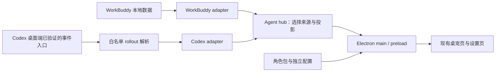

# v0.4.0 技术方案

状态：2026-10-15 用户批准按本版开发，子代理预审后实施中。代码基线：`9ff3645`。本文件同时作为 Superpowers 规格文档，不另建 spec 副本。先交付 Windows 验证版；Mac 代码兼容随版实现，实机由用户后续验证，未实测不阻塞 Windows PR。

关联：[需求与验收](requirements.md) · [开发计划](plan.md) · [验证](verification.md)

## 1. 现状与问题

现有 Electron 主进程 `electron/main.js` 管理窗口、配置、包扫描和状态读取；`scripts/state-core.js` 专门解释 WorkBuddy 数据；`prototype/v2/index.html` 负责差分、台本与互动。保留此结构，只抽出本版需要稳定复用的边界。

已确认的现状：

- 启动 / 构建依赖 Windows 的 `electron.exe`、`npm.cmd`；`run.sh` 也仍指向 `.exe`。
- main 与页面缩放上限分别为 5 和 2.5；设置可列出的包布局少于扫描器实际支持的布局。
- WorkBuddy 数据不存在时连续失败可进入错误表情；关闭显示检测没有同时停止主进程采集。
- 切换 `series` 会重置部分映射；台本、语音、互动主要仍为全局配置。
- 缺失角色差分会回退到美代，角色资源并未真正隔离。

既有静态检查与 29 项状态测试通过只说明现有覆盖通过，不能证明上述缺陷不存在，也不能证明 Mac 或 Codex 可用。

## 2. 方案选择

| 路线 | 收益 | 代价 | 决策 |
| --- | --- | --- | --- |
| 沿用现有 Electron，新增来源适配、配置 / 包边界 | 可保留台本、互动、设置和 Windows 行为，逐模块回归 | 需要谨慎兼容现有大文件 | 采用 |
| 重写为新桌面框架或 Web 前端 | 可能获得新的工程结构 | 重做窗口、资源与设置，首版风险和工作量过大 | 本版不采用 |
| 只改平台脚本、在渲染页继续拼接来源 | 初期改动少 | Agent 语义混乱、角色仍串用配置，难以可靠验证 | 不采用 |

本版不做通用插件系统。新增模块为 CommonJS，优先使用 Node / Electron 内置 API；新增运行时依赖必须说明必要性和体积，不为未来需求预装。

## 3. 目标数据流与文件边界



拟新增文件；未在本次文档阶段创建产品模块：

| 文件 | 单一职责 |
| --- | --- |
| `scripts/agents/schema.js` | 归一事件 / 快照验证与展示投影 |
| `scripts/agents/workbuddy.js` | 包装既有 state-core，标记可用性，保留任务数量语义 |
| `scripts/agents/codex.js` | 消费最小事件、维护已验证生命周期、去重和重放恢复 |
| `scripts/agents/hub.js` | 来源选择、启停、快照分发；不解释原始 Agent 文件 |
| `scripts/codex-event.js` | rollout 白名单解析器；仅输出允许的元数据，不另存对话 |
| `electron/platform-paths.js` | 内置只读目录、外部可写目录、标准 file URL |
| `electron/character-packs.js` | 包发现、兼容旧布局、清单验证与当前角色回退 |
| `electron/config-store.js` | schema 迁移、备份与原子写入、角色配置隔离 |

`electron/main.js` 只接线、管理 Electron 生命周期和 IPC；`preload.js` 保留最小 API。页面仍是现有 HTML，不借此整体拆重构。`scripts/state-core.js` 继续作为 WorkBuddy 解析唯一真源。

## 4. Agent 契约

### 4.1 统一快照

适配器输出 `AgentSnapshot`，字段约定如下：

```text
schemaVersion: 1
provider: "workbuddy" | "codex"
health: "unconfigured" | "ready" | "stale" | "error"
sessionId: string | null
turnId: string | null
phase: "unknown" | "idle" | "running" | "awaiting_approval" |
       "awaiting_input" | "completed" | "interrupted" | "failed"
counts: { processing: number|null, pending: number|null, approval: number|null }
completionKey: string | null
observedAt: number                 本机接收时间，毫秒
rev: number                        hub 对外统一分配，本次桌宠进程内单调递增
reason: string | null              稳定原因码，不含原始错误正文
capabilities: { lifecycle, waitingApproval, waitingInput, sessionClosed }
```

- `null` 代表来源未提供数量；不能把一个正在运行的回合解释成若干任务。Codex 只显示状态，未证明存在的任务数胶囊隐藏。
- adapter 内部版本不得直接作为页面 rev；hub 串行处理来源启停，过滤上一生命周期回调，切换来源也必须递增对外 rev。归一宿主的完成提示只接受 completionKey，禁止页面根据计数下降自行推断完成；切换 / 禁用 / 中断清除旧来源的瞬态完成与失败。
- `health` 是接入质量，`phase` 是工作状态。路径尚未配置不等于任务出错；已接入后读取失败保留最后有效状态并标记降级，不产生 `completionKey`。
- 没有事件不等于断连；长时间待机或等待批准不能仅因“最后活动很久以前”变成错误。`stale` 必须来自读失败、明确连接丢失或重启后无法确认旧运行状态等可解释条件。
- 适配器工厂为 `createAdapter(options)`，返回 `start(emit)`、`refresh()`、`stop()`；三个方法都返回 Promise，`start` / `stop` 结果为 void，`refresh()` 结果为 `AgentSnapshot`。`emit(snapshot)` 同步接收完整快照，不能由调用方改写；`start` / `stop` 幂等，`stop()` 释放 watcher、timer 和子进程，关闭后禁止后续 emit。
- hub 工厂为 `createHub({ adapters, activeProvider, onSnapshot })`；接口为 `setActiveProvider(id)`、`setEnabled(id, enabled)`、`getSnapshot()`、`dispose()`。除同步读取的 `getSnapshot(): AgentSnapshot` 外均返回 `Promise<void>`。首版一个活动来源，未选来源不参与桌宠表情；不做跨来源计数相加。

### 4.2 与现有桌宠状态兼容

通过 `toPetState(snapshot)` 投影到现有 `PetSnapshot` 可消费字段；原始 `provider / health / phase / nullable counts` 一并传入设置页和状态胶囊。旧数值字段只为兼容页面，不能据其显示不存在的数量。

| 归一状态 | 桌宠表现 |
| --- | --- |
| unconfigured / unknown | 待机，并在设置中解释尚未接入 |
| ready + running | processing |
| ready + awaiting_approval | approval |
| ready + awaiting_input | 待用户输入提示，复用等待类台本；与待办任务文案区分 |
| ready + completed | 同一 `completionKey` 最多触发一次 justDone，然后回待机 |
| interrupted | 结束本轮并回待机，不显示成功庆祝 |
| ready + failed | 任务失败表情 |
| stale / error | 保留最近有效画面并标明来源异常；没有有效画面则待机 |

WorkBuddy 的 pending 继续表示真实待办任务，仍使用原有 pending 状态。来源故障与任务失败不能都投影成旧 `error: true`。

### 4.3 Codex 桌面入口与支持边界

2026-10-15 已核对 Windows 桌面应用 `26.1007.9446.0`，内嵌 CLI `0.162.0-alpha.17.2`。当前 Windows 桌面 App Server 使用内部 stdio，另启服务不能订阅现有桌面聊天。hooks 的 Stop 不是可靠终态，也缺少完整等待请求 / 解决配对，因此首版改为只读本地 rollout。用户明确批准首版支持可靠生命周期，批准 / 输入等待后续补齐。

兼容门槛采用已核对 CLI 版本白名单，未知版本给出不支持说明，不按近似格式猜测。该入口是公开源码的文件实现，不是官方稳定订阅 API。当前桌面真实文件 source 为 vscode，不能据此区分桌面和 VS Code 扩展；通过用户填写的桌面聊天 ID 显式绑定，只按文件名定位对应 ID，核对 session_meta.id，不遍历其他聊天正文。提供 codexHome（默认用户目录下 .codex）与 threadId 两项全局配置；不读取认证文件。

| 源事件 | 最小字段 | phase | 能力 |
| --- | --- | --- | --- |
| event_msg / task_started（或 turn_started 别名） | turn_id | running | 生命周期 |
| event_msg / task_complete（或 turn_complete 别名） | turn_id、error 是否非空 | completed / failed | 生命周期 |
| event_msg / turn_aborted | turn_id、受控 reason | interrupted | 生命周期 |
| 审批 / 输入等待、会话关闭 | 当前不持久化 | 不推测 | unsupported |

Codex counts 全为 null；capabilities 为 lifecycle:true、waitingApproval:false、waitingInput:false、sessionClosed:false。running 表示回合开始后尚未观察到终态，界面说明“回合进行中，无法细分等待”，不能暗示持续生成。

依据为与本机一致的官方标签：[持久化策略](https://github.com/openai/codex/blob/rust-v0.162.0-alpha.17.2/codex-rs/rollout/src/policy.rs#L127)、[生命周期字段](https://github.com/openai/codex/blob/rust-v0.162.0-alpha.17.2/codex-rs/protocol/src/protocol.rs#L2133)、[失败写入](https://github.com/openai/codex/blob/rust-v0.162.0-alpha.17.2/codex-rs/core/src/tasks/mod.rs#L814)。[官方 hooks 文档](https://learn.chatgpt.com/docs/hooks#common-input-fields)也说明 transcript 格式不是稳定 API。

### 4.4 rollout 读取、恢复与最小状态协议

scripts/codex-event.js 提供纯解析接口。源文件包含对话，只在主进程侧解析，仅将生命周期白名单字段输出到 adapter，其他字段立即丢弃；禁止转发、记录日志或另存原文。失败仅取 error 非空标志，不输出错误正文。自有最小事件为：

```text
{ schemaVersion:1, provider:"codex", sessionId, turnId,
  kind, eventId, sourceTime, sourceSequence, streamId, observedAt }
kind = turn_started | turn_completed | turn_interrupted | turn_failed
```

- 线程身份取 meta.id，不取可由子 agent 共享的 session_id。只接受 user 根线程，排除 parent、Internal/SubAgent 对象来源与非 user 的 thread_source。异常元数据降级，不借其他聊天补齐。
- 同文件以稳定文件身份、字节偏移及可选 ordinal 排序；时间只作展示。完整换行后推进游标，半行等待；无效行 / 异常字段降级，限制单行缓存。替换 / 截断静默重建，旧游标失效。
- 初次读取、重启、重新启用只重建历史，不庆祝。历史 start 无终态输出 stale + unknown（上次回合状态未确认）：该版本 SuspendTurnAndShutdown 可停止回合而不写终态。监听后新 start 才确认 running。不因长时间无事件假定断连。
- 同 turn 终态不能被晚到 start 逆转，旧 turn 终态不能覆盖较新 turn。无 turnId 的 aborted 只在唯一活动回合可配对时处理，否则 unknown。ThreadRolledBack 静默重建且不庆祝；fork 继承历史不能作为新完成。
- eventId 按文件身份 / 偏移 / 类型稳定构造；完成键为 threadId + turnId，先原子持久化已提示键和读取摘要，再发 completionKey。摘要放 eventDir，不复制原文；持久化失败不庆祝。读失败保留 lastGood 并标记降级。
- start / refresh / stop 遵守 4.1；关闭释放 timer / watcher，不再读文件或 emit。用户源文件只读，不注册 hooks、不修改信任状态、无网络端点。未来增加 hooks 时另行设计配对及恢复流程。

## 5. 平台与路径

- `platform-paths.js` 提供 `resolvePaths({ platform, userDataDir, appRoot, portableDir })`，返回 `{ resourceRoot, configDir, packRoots, presetDir, eventDir }`；额外可接受 exeDir / isPackaged 以保留 Windows 目录版。Mac 预设保存、删除、打开目录均使用 userData 下的 presetDir，不落入 `.app`。纯函数可在无 Mac 的 Node 测试中验证。
- 内置图片与默认包来自只读资源目录。Mac 的用户配置、外部 packs、事件固定放 `app.getPath('userData')` 下；不以 `.app` 所在目录作为写入位置。
- Windows 保留显式 portable / 既有用户配置位置和 exe 旁 packs 的兼容；旧路径发现只读探测，迁移先备份，不搬走用户素材。开发态可显式指定测试目录。
- 所有文件 URL 使用 `pathToFileURL`，不手写 `file:///` 拼接，覆盖中文、空格、`#`、`%`。
- 原生 Mac 启动脚本不引用 `.exe` / `npm.cmd`。现有 Windows 脚本保留，Mac 构建使用 electron-builder 的 mac 目标，分别产出 arm64 / x64 `.app`（可用 zip 封装）。
- 当前锁定 Electron 版本先保持不变。Mac 构建不复用 Windows `electronDist`；签名 / 公证另列公开分发前置条件，不冒充已完成。
- Electron 窗口 API 按平台封装必要差异；首版保证透明、拖动、设置、菜单、音频和可见性恢复。屏幕 workArea 计算包含 `x/y`；找不到原屏幕时夹回主屏可见范围。高级位置记忆 / 贴边留待后续。
- 今日积分仍是 WorkBuddy 可选能力；Mac 没有可用 sidecar 运行时时隐藏，不阻塞桌宠。不要复制查找 `node.exe` 的路径规则到 Mac。

参考：[Electron 窗口](https://www.electronjs.org/docs/latest/api/base-window)、[electron-builder macOS](https://www.electron.build/mac/)。操作系统最低支持以实际 Electron 版本的官方说明和验证记录共同标注。

## 6. 角色与配置

### 6.1 包发现及最小清单

统一 `discoverPacks(roots)` 的返回值，扫描、设置列表和加载使用同一结果，不各自枚举。

该函数返回 `Promise<PackDescriptor[]>`；描述符包含 `{ id, label, modes, defaults, attribution, warnings }`。`modes` 为 `{ v1: ModeDescriptor|null, v2: ModeDescriptor|null }`；每个模式描述符含 `{ rootDir, sprites, defaultSpriteId }`，其中 `sprites` 是编号到绝对文件路径的普通对象。主进程统一转换为 file URL 后发送页面，不把任意目录读取能力交给页面。

- 保留 `packs/<id>/{v1,v2}` 和 `packs/{v1,v2}/<id>`；同一 root 内优先前者，缺少模式时才补后者；根目录按 `packRoots` 顺序优先。同 ID 同模式冲突只采用一个并报告来源。
- 新清单可声明 `schemaVersion:1`、`id`、`label`、`preview`、`sprites`（v1/v2 的编号 → 相对路径）、`defaults`（默认语义映射 / 台本 / 语音等）、`attribution`。id 为稳定包身份，不使用中文显示名充当身份。
- 旧 label-only 清单使用 `legacy:` 加 `encodeURIComponent(角色目录名)` 生成 ID，两种布局采用同一目录名规则，保留原 `series` 对应关系；内置美代固定为 `miyo`。重命名目录前可补显式 ID 维持身份，不靠显示名或绝对路径误识别为同一角色。
- 资源路径必须位于包根内；清单只含数据，不执行 JS。非法 JSON、缺少全部图片、路径越界的包不能成为活动角色；保留上一个有效角色并提示。
- 同角色缺号回退：指定 ID → 当前角色该模式的默认 ID → 当前角色首个可用 ID。该模式无素材时提示切换模式 / 包不可用，不跨角色取图。
- 没有角色台词 / 语音时允许静默；不要用美代默认台词或音频补别的角色。
- 本版不增加一键下载或 zip 导入系统；保留目录包兼容。现有 Windows zip 行为需回归，Mac 不在未验证前宣称 zip 自动解压可用。

### 6.2 配置 schema 与角色隔离

配置升级为 `schemaVersion:2`，核心结构：

```text
activeCharacterId: string
global: { agent, window, reminders, ... }
characters: {
  [characterId]: {
    mapping, scripts, voices, reacts, hourly,
    idleSprs, restSprs, lines,
    display: { mode, scale, lowMem, bubble, pill }
  }
}
```

`global` 保存 Agent 选择、检测开关、窗口开关和用户日程；角色拥有表现相关设置。提醒的时间 / 内容属于全局，触发时用当前角色已定义的表现；不为每个角色重复创建同一日程。

接口：`migrateConfig(raw, selectedLegacyId)` 同步返回 `{ config, changed }`，其中 raw 为已解析对象；先发现包，再由 `readConfig(file, { resolveLegacyId }): Promise<ConfigV2>` 解析旧目录身份并负责备份、迁移和校验。缺包保留其原身份和配置，不转移给美代。`writeConfig(file, config): Promise<void>` 采用同目录临时文件 + rename；`getCharacterConfig(config, id, defaults)` 同步返回该角色配置，只在读取时合并默认与用户覆盖。配置不存在才创建默认配置；损坏或不兼容时抛出稳定错误码并由主进程提供恢复入口，不自动覆盖。页面所需旧字段通过投影提供，不在磁盘维护第二套全局副本。

现有可写字段归属：

| 归属 | 字段 |
| --- | --- |
| 全局 Agent / 窗口 | alwaysOnTop、scope、dropStale、showApproval、approvalTtlMs、convWindowMs、usage、detect、新 agent 选择 |
| 角色表现 | mapping、lines、voices、reacts、scripts、restSprs、idleSprs、idleSprMs、idleBlink、idleSway、idleBreathe、stateCycleMs、idleSecs、scriptRestMs、volume、hourly、hourlyGraceMs |
| 角色显示 | mode、scale、lowMem、bubble、pillVisible、pillText、pillPos，以及清洗器当前支持的气泡 / 胶囊样式字段 |
| 提醒 | id / name / 时间 / 频率 / enabled / done / lastFired 为全局；scripts / ackScripts 按 reminder ID 归角色，旧版完整提醒迁移后保持等效 |
| 元信息 | _v、schemaVersion、revision、activeCharacterId；series 为兼容投影；packIds / packFiles / URLs 等为运行时派生，不作为用户覆盖 |

实现时以 normalizeConfig 与设置页写入字段核对完整性，新识别的可写字段必须归类且补迁移测试；未知字段保留。旧预设导入先经过同一迁移，应用到其声明角色；跨角色应用需显式选择，不覆盖其他角色。

迁移步骤：

1. 读取原始内容，先做原样备份，再解析 / 校验；损坏文件保留，不以默认配置自动覆盖。
2. 把现有角色表现设置归给原 `series` 对应角色；缺少 `series` 才使用内置美代 ID。
3. 提取全局开关与日程；保留未知字段。再次迁移 schema 2 不新增角色或重置数据。
4. 迁移结果通过校验才原子写入；备份恢复方式写入用户说明。旧版应用读取新版配置不作兼容承诺，降级使用备份。

保存请求必须携带 `{ characterId, baseRevision, patch }`；主进程串行提交，拒绝角色身份或 revision 过期的请求并返回最新投影。旧设置窗口不得将平面整套配置写给当前新角色。切换流程：先保存当前角色 → 校验目标包 → 生成候选配置 → 原子持久化活动 ID 与新 revision → 广播新投影并取消旧台本 / 音频。写失败保持旧角色；切换代数 token 使旧图片 / 音频回调失效。

## 7. 性能与测试边界

- 不新增同步递归扫描到渲染进程；首次发现后复用包清单，手动刷新或变化时更新。
- Agent 关闭、窗口退出时释放资源；配置写入串行化，避免最后一次旧保存覆盖新角色。
- 保留 `contextIsolation` 和最小 preload，不为接入 Agent 给页面开放任意文件读写或 shell。
- 自动测试使用合成目录、事件与角色夹具，避免真实账号 / 对话和第三方游戏素材入库。
- 状态、迁移、包回退用 Node 测试；DOM / 图片加载用真实 Chromium；透明窗口、菜单、Mac 构建及 Codex 桌面信号必须实机验收。
- 本版不承诺未经测量的 CPU / 内存数字；记录可重复的启动、待机和切换观察，出现相对基线明显退化时再定位。

## 8. 决策与风险记录

| 日期 | 决策 / 风险 | 处理 |
| --- | --- | --- |
| 2026-10-15 | 保留 Electron 和现有页面 | 限定抽取模块，避免重写扩大首版 |
| 2026-10-15 | Codex 桌面端优先，事件入口尚未证实 | T1 先验证；不足则评审，不改称 CLI 已完成 |
| 2026-10-15 | 当前开发环境是 Windows | Mac 自动检查与真实产物验收分开记录 |
| 2026-10-15 | 角色全局配置会互相污染 | schema 迁移、备份、隔离和快速切换回归 |
| 2026-10-15 | 首版是多个可独立评审的模块 | 同一方案定义共享契约，计划按模块划分 PR，不复制子规格 |
| 2026-10-15 | 文档采用正式版本目录 | 本文件替代技能默认 spec 路径，计划和验证各保留一个文件 |
